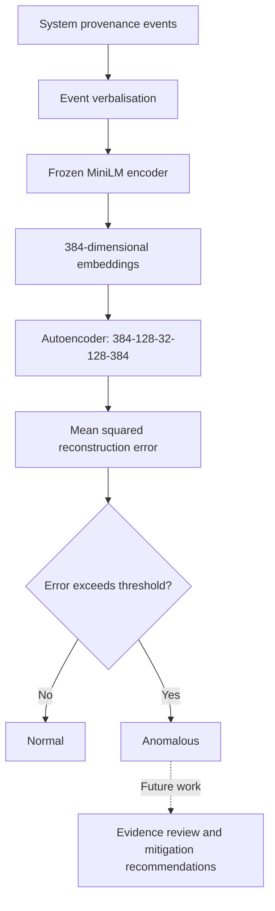

# APT Detection Research

**Research title:** AI-based solution to detect and mitigate APT malware

**Status:** Early proof of concept — synthetic anomaly detection completed; real dataset evaluation pending.

## Overview

This research investigates whether semantic representations of system provenance events, combined with a benign-trained autoencoder, can identify anomalous behaviour relevant to Advanced Persistent Threats (APTs). A future mitigation component will investigate evidence-grounded, human-reviewed response recommendations.

## Objectives

- Convert structured process, file and network events into consistent natural-language descriptions.
- Generate embeddings using frozen pretrained language encoders.
- Train an autoencoder using benign events and flag unusual reconstruction errors.
- Evaluate detection performance on CICAPT-IIoT, subject to dataset availability and schema verification.
- Compare against simpler baselines and investigate MITRE ATT&CK alignment and mitigation recommendations.

## Architecture



Training uses benign embeddings only. A separate benign validation set calibrates the threshold. Inference uses the saved model without updating weights. The current prototype starts with manually written descriptions; real event ingestion and verbalisation are not yet implemented.

## Technology stack

| Component | Technology |
|---|---|
| Environment | Ubuntu 24.04.5 LTS on WSL2 |
| Python | 3.12.3 |
| GPU | NVIDIA RTX 4060, 8 GB VRAM |
| Deep learning | PyTorch with CUDA |
| Semantic encoder | sentence-transformers/all-MiniLM-L6-v2 (~22.7M parameters) |
| Autoencoder | Custom PyTorch MLP (107,168 trainable parameters) |
| Data and evaluation | NumPy, Pandas, PyArrow, scikit-learn |
| Experimentation | Matplotlib, JupyterLab |

PyTorch and MiniLM are current prototype choices; confirm any deviation from the approved research proposal with the supervisor. MPNet and BERT are candidate comparison encoders, not implemented results.

## Project structure

```text
APT-Detection-Research/
├── data/
│   ├── raw/
│   ├── processed/
│   └── embeddings/
├── src/
│   ├── test_embeddings.py
│   ├── autoencoder.py
│   ├── train_demo.py
│   └── detect_demo.py
├── models/
│   └── autoencoder_demo.pt
├── results/
│   └── training_loss_demo.png
├── notebooks/
├── experiments/
├── tests/
├── knowledge/
├── requirements.txt
├── README.md
└── AGENT.md
```

Directory layout is the intended local structure; generated artifacts and dependency manifest should be verified locally.

## Setup

From the project root on Ubuntu:

```bash
python3 -m venv .venv
source .venv/bin/activate
python -m pip install --upgrade pip setuptools wheel
python -m pip install torch --index-url https://download.pytorch.org/whl/cu128
python -m pip install pandas numpy pyarrow scikit-learn scipy transformers sentence-transformers jupyterlab ipykernel matplotlib tqdm python-dotenv pyyaml pytest
python -m pip check
python -m pip freeze > requirements.txt
```

The CUDA 12.8 wheel index was selected for the prototype setup. Verify the installed build and record exact versions rather than assuming them. For reproducibility, retain the dependency manifest and CUDA wheel source.

```bash
python -c "import torch; print(torch.__version__, torch.version.cuda, torch.cuda.is_available())"
mkdir -p models results
```

MiniLM downloads public weights on first use. A Hugging Face token is optional for public downloads; never commit tokens.

## Run the proof of concept

```bash
python src/test_embeddings.py
python src/train_demo.py
python src/detect_demo.py
```

Run from the repository root. Training creates the checkpoint and loss graph; detection requires the checkpoint. The embedding model remains frozen. Clone inference tensors outside inference mode before passing them into gradient-tracked training.

## Initial experiment — 25 November 2026

Synthetic data: 15 benign training descriptions, 5 separate benign validation descriptions, 8 unseen test descriptions. MiniLM embeddings are L2-normalised. Autoencoder uses Adam (learning rate 0.001), MSE loss, 200 epochs and seed 42. Threshold: 95th percentile of benign validation errors.

| Metric | Observed value |
|---|---:|
| Training loss at epoch 20 | 0.00174326 |
| Training loss at epoch 200 | 0.00000388 |
| Threshold | 0.0010196679504588246 |
| Normal predictions | 4 |
| Anomalous predictions | 4 |

| Test event | Reconstruction error | Prediction |
|---|---:|---|
| A user opens a spreadsheet document. | 0.00047158 | NORMAL |
| A service writes routine diagnostic logs. | 0.00077781 | NORMAL |
| An application reads its configuration. | 0.00047594 | NORMAL |
| A database service retrieves a record. | 0.00027753 | NORMAL |
| A process accesses stored credentials. | 0.00160841 | ANOMALOUS |
| A process modifies system security settings. | 0.00159507 | ANOMALOUS |
| An application establishes an external connection. | 0.00185607 | ANOMALOUS |
| A process transfers confidential files. | 0.00152142 | ANOMALOUS |

These results establish technical feasibility only. The tiny synthetic dataset, high model capacity and small validation set create substantial overfitting and threshold uncertainty. Anomaly scores are not malware probabilities; unfamiliar legitimate behaviour can trigger alerts. No validated accuracy, APT attribution or mitigation effectiveness is established.

## Roadmap

- [x] WSL2, Python and GPU setup
- [x] MiniLM embedding and similarity experiment
- [x] Custom autoencoder training and checkpoint generation
- [x] Synthetic anomaly detection demonstration
- [ ] Acquire and inspect CICAPT-IIoT documentation, licence, schema and ground truth
- [ ] Implement deterministic event verbalisation and preprocessing
- [ ] Design leakage-resistant train/validation/test splits
- [ ] Train on real benign data and calibrate threshold
- [ ] Compare TF-IDF, PCA and Isolation Forest baselines; assess alternative encoders
- [ ] Report precision, recall, F1, ROC-AUC, PR-AUC/AP and confusion matrices
- [ ] Investigate event sequence/context and ATT&CK alignment
- [ ] Develop and evaluate human-reviewed mitigation recommendations
- [ ] Optional API/dashboard after research pipeline validation

## References and resources

- [MiniLM model card](https://huggingface.co/sentence-transformers/all-MiniLM-L6-v2)
- [PyTorch installation](https://pytorch.org/get-started/locally/)
- [CICAPT-IIoT paper](https://arxiv.org/abs/2407.11278)
- [APT-LLM paper](https://arxiv.org/abs/2502.09385)
- [MITRE ATT&CK](https://attack.mitre.org/)
- [MITRE D3FEND](https://d3fend.mitre.org/)

Research links are starting points; verify access, bibliographic details and relevance before formal citation.

## Safety and data handling

Defensive research only. Use authorised datasets and isolated environments. Do not execute malware on the host, expose sensitive logs, commit credentials or redistribute restricted datasets. Automated remediation is not implemented. Dataset and code licensing must be confirmed before public distribution.
